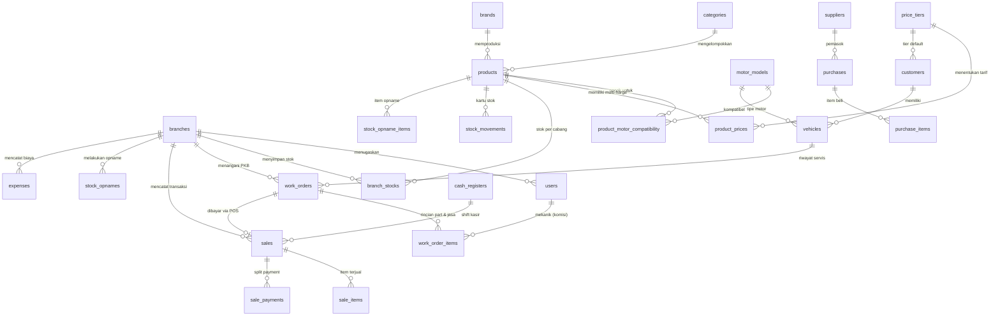

# PRODUCT REQUIREMENTS DOCUMENT (PRD)
**Nama Sistem:** Sistem POS Penjualan Sparepart Motor & Manajemen Bengkel Multi-Cabang  
**Versi Dokumen:** 2.0 (Final Unified Specification)  
**Referensi Arsitektur:** Pola Alur Kerja & Modul *Stock Manager Advance (SMA) v3.5*  
**Stack Teknologi:** Laravel 11, Filament v3, Livewire, Alpine.js, MySQL 8.0+  

---

## 1. Ringkasan Eksekutif & Ruang Lingkup
Aplikasi ini adalah sistem *Enterprise Resource Planning* (ERP) ringan berbasis web untuk mengelola operasional **penjualan suku cadang (ritel & grosir)** dan **layanan jasa bengkel motor** di banyak cabang secara *real-time*. 

Sistem menggabungkan keandalan manajemen inventori multi-gudang dan terminal kasir cepat ala **Stock Manager Advance (SMA) v3.5**, diperluas dengan fitur spesifik otomotif: **Perintah Kerja Bengkel (PKB / Work Order)** berbasis Nomor Polisi, **Sistem Komisi Mekanik**, **Multi-Harga Dinamis** (Eceran, Grosir, Spesial Grosir, hingga Custom Tier), **Barcode Stock Opname**, **Import/Export Excel**, serta **Laporan Laba-Rugi (Profit & Loss) Real-time** per cabang maupun konsolidasi pusat.

---

## 2. Role-Based Access Control (RBAC)
Hak akses diatur secara granular dan terisolasi berdasarkan penugasan cabang (`branch_id`):

| Role | Cakupan Akses | Wewenang & Tanggung Jawab Utama |
| :--- | :--- | :--- |
| **Super Admin / Owner** | Semua Cabang (Konsolidasi) | Akses penuh seluruh sistem, kelola cabang & master tingkatan harga, lihat HPP & Real-time P&L konsolidasi, approval selisih opname besar, import/export master data. |
| **Branch Manager** | 1 Cabang Spesifik | Monitoring transaksi & operasional cabang, approval hasil *Stock Opname*, input beban operasional cabang, lihat laporan P&L cabang. |
| **Kasir / Front Desk** | 1 Cabang Spesifik | Operasional Web POS Terminal (scan barcode), buka/tutup shift *Cash Register*, buat PKB, kelola *Hold/Suspend Bill*, ubah *Price Tier* pelanggan, proses *Split Payment*, cetak struk. |
| **Kepala / Admin Gudang** | Gudang Pusat / Cabang | Input Purchase Order (PO) & penerimaan barang, *Stock Transfer* antar cabang, cetak label barcode, import/export stok, dan eksekusi **Barcode Stock Opname**. |
| **Service Advisor (SA)** | 1 Cabang Spesifik | Registrasi kendaraan (Plat Nomor), input keluhan & estimasi PKB, penunjukan mekanik, pantau status pengerjaan motor, kirim pengingat servis via WhatsApp. |
| **Mekanik** | 1 Cabang Spesifik | Lihat daftar antrean PKB yang ditugaskan, update status pengerjaan (*Dikerjakan / Selesai*), lihat riwayat komisi pribadi. |

---

## 3. Spesifikasi Fungsional Modul

### Modul 1: Master Data Sparepart, Kompatibilitas & Multi-Harga Dinamis
* **Identitas & Atribut Sparepart:**
  * Kode SKU (Unik), Kode Barcode (EAN-13 / Code-128 / Auto-generate internal), Nama Part, Kategori (Oli, Ban, Kampas Rem, Kelistrikan, dll.), Merek, dan Satuan (Pcs, Set, Botol, Liter).
  * **Kualitas Part:** Pembedaan label kualitas (`Original / OEM`, `Aftermarket`, `Lokal`).
  * **Kompatibilitas Tipe Motor:** Penandaan multi-tipe motor pada satu produk (contoh: satu kampas rem dapat ditandai kompatibel untuk *Vario 125, Vario 150, PCX 150*) agar kasir dan mekanik mudah mencari part berdasarkan jenis motor pelanggan.
  * **Lokasi Rak (Bin Location):** Kode penyimpanan spesifik per gudang cabang (misal: `RAK-A02`).
* **Sistem Multi-Harga Dinamis (Dynamic Price Tiers):**
  * Menyediakan 3 tingkatan harga bawaan: **Harga Eceran (Default)**, **Harga Grosir**, dan **Harga Spesial Grosir**.
  * Super Admin dapat **menambah jenis harga custom baru** kapan saja (misal: *Harga Bengkel Rekanan VIP*, *Harga Komunitas/Ojol*, *Harga Marketplace*) tanpa mengubah struktur sistem.
  * Setiap produk dapat memiliki nominal harga berbeda untuk tiap tingkatan harga, lengkap dengan opsi syarat kuantitas minimum (`min_qty`).
* **Sistem Barcode & Cetak Label:**
  * Mendukung pemindaian menggunakan *USB/Wireless/Bluetooth Barcode Scanner* maupun **Kamera HP/Tablet** langsung dari browser.
  * Fitur cetak stiker label barcode (mendukung printer label thermal 33x15mm / 50x30mm dan kertas stiker A4) yang memuat Nama Part, SKU, Barcode, dan Harga Eceran.
* **Katalog Jasa Servis:** Daftar layanan non-stok (Servis Ringan, Ganti Oli, CVT, Turun Mesin) dengan tarif standar dan pengaturan komisi mekanik (persentase `%` atau nominal tetap `Rp`).

### Modul 2: Manajemen Bengkel & Work Order (PKB)
* **Database Kendaraan & Pelanggan:**
  * Registrasi menggunakan **Nomor Polisi (Plat Nomor)** sebagai kunci pencarian utama, dilengkapi Tipe Motor, Nomor Rangka/Mesin, Kilometer (KM) saat ini, estimasi KM servis berikutnya, Nama Pemilik, dan Nomor WhatsApp.
  * Setiap pelanggan/bengkel rekanan dapat ditautkan ke *Price Tier* default tertentu.
* **Alur Kerja Perintah Kerja Bengkel (PKB):**
  1. **Check-in (`Queued`):** SA mencatat keluhan pelanggan, memilih mekanik utama, dan menyusun estimasi sparepart/jasa.
  2. **Pengerjaan (`In-Progress`):** Mekanik/Admin gudang menambahkan sparepart yang terpakai (via scan barcode atau pencarian) dan jasa tambahan.
  3. **Selesai (`Ready for Payment`):** Mekanik menandai motor selesai; PKB otomatis muncul di layar antrean Kasir POS untuk ditagihkan.
* **Riwayat Servis Lintas Cabang & WhatsApp Reminder:**
  * Menampilkan histori lengkap penggantian sparepart, tanggal servis, KM terakhir, dan catatan mekanik berdasarkan Plat Nomor di cabang mana pun.
  * Tombol pengingat jadwal servis berkala / ganti oli langsung terhubung ke WhatsApp pelanggan.

### Modul 3: Touch-Friendly Web POS Terminal (SMA v3.5 Pattern)
* **Antarmuka Kasir Cepat & Barcode Ready:**
  * Desain responsif ramah layar sentuh (*tablet/touchscreen monitor*) dengan grid kategori visual.
  * Kolom pencarian *auto-focus*: setiap tembakan barcode scanner langsung memasukkan item ke keranjang dan menambah kuantitas (`+1`) jika di-scan berulang.
* **Transaksi Hibrida & Switching Harga Instan:**
  * Menggabungkan penjualan sparepart fisik dan jasa servis (beserta nama mekanik) dalam satu keranjang transaksi.
  * Kasir dapat mengganti *Price Tier* transaksi (Eceran $\leftrightarrow$ Grosir $\leftrightarrow$ Spesial Grosir $\leftrightarrow$ Custom Tier) dengan satu klik, dan harga seluruh item di keranjang otomatis menyesuaikan.
* **Hold / Suspend Bill (Antrean Tagihan):**
  * Menyimpan transaksi yang belum dibayar ke daftar *Suspended Bills* dengan label identifikasi (misal: `"BE 4512 XY - Pak Budi"` atau `"Bengkel Maju Jaya"`) agar kasir dapat melayani pelanggan berikutnya tanpa hambatan.
  * Transaksi dari PKB yang telah selesai otomatis masuk ke daftar tagihan siap bayar.
* **Shift Kasir & Pembayaran:**
  * Manajemen buka/tutup kasir (*Cash Register*) dengan pencatatan modal awal dan rekonsiliasi uang fisik di laci vs sistem.
  * Dukungan **Split Payment** (kombinasi Tunai, QRIS, Transfer Bank, Kartu Debit) serta cetak struk thermal (58mm/80mm) dan faktur/invoice ukuran A4/A5.

### Modul 4: Multi-Warehouse Inventory, Transfer & Barcode Stock Opname
* **Stok Real-time per Cabang:** Setiap cabang memiliki pencatatan stok mandiri yang berkurang secara atomik saat transaksi POS selesai (`Completed`).
* **Stock Transfer (Mutasi Antar Cabang):**
  * Alur terkontrol: `Draft/Request` $\rightarrow$ `In-Transit` (stok cabang pengirim berkurang saat barang dikirim; mendukung scan barcode saat *packing*) $\rightarrow$ `Completed` (cabang penerima melakukan scan barcode verifikasi barang datang sehingga stok cabang tujuan bertambah).
  * Cetak dokumen **Surat Jalan Mutasi Barang**.
* **Barcode Stock Opname & Cek Stok Instan (Khusus Kepala/Admin Gudang):**
  1. **Mode Cek Stok Cepat (*Quick Scan Check*):** Admin gudang cukup membuka halaman pemindai (via PC scanner tembak atau HP/Tablet kamera) dan menembak barcode sparepart. Layar seketika menampilkan Nama Part, SKU, Lokasi Rak (`Bin Location`), **Stok Sistem saat ini**, status stok minimum, dan daftar harga tiap *tier* tanpa mengubah data apa pun.
  2. **Mode Sesi Stock Opname (*Scan-to-Count*):**
     * Admin Gudang membuka sesi opname baru (dapat dibatasi per **Lokasi Rak**, per **Kategori**, atau **Seluruh Gudang**).
     * Admin berkeliling rak dan memindai barcode setiap barang fisik (mendukung mode *Continuous Scan* `+1` per *beep* maupun input kuantitas langsung untuk barang dalam dus).
     * Sistem menampilkan perbandingan **Stok Sistem**, **Stok Fisik (Hasil Scan)**, dan **Selisih (`+/-`)** secara *real-time*.
     * Barang dalam target rak/kategori yang belum ter-scan otomatis ditandai merah (*Belum Dihitung*) agar tidak ada barang terlewat.
     * Setelah sesi ditutup, *Branch Manager / Owner* melakukan *Approval* untuk menyesuaikan saldo stok sistem secara otomatis beserta pencatatan nilai selisihnya ke jurnal P&L.

### Modul 5: Import & Export Excel Terintegrasi
Sistem menyediakan utilitas file Excel (`.xlsx` / `.csv`) dengan template standar dan validasi baris otomatis:

| Menu / Modul | Fitur Import Excel | Fitur Export Excel |
| :--- | :--- | :--- |
| **Master Sparepart & Multi-Harga** | Import massal produk baru beserta kolom harga dinamis (`harga_eceran`, `harga_grosir`, `harga_spesial_grosir`, `harga_{custom_tier}`). | Export seluruh katalog sparepart, barcode, atribut motor, HPP, dan seluruh tingkatan harga aktif. |
| **Update Harga Massal** | Upload perubahan harga beli/jual massal berdasarkan kecocokan `SKU` atau `Barcode`. | Export daftar harga aktif per kategori atau merek. |
| **Stok Awal & Adjustment** | Import saldo awal stok dan lokasi rak (`bin_location`) per cabang saat migrasi data awal. | Export posisi stok saat ini, valuasi aset gudang, dan kartu stok (*Stock Card*). |
| **Stock Opname** | Import hasil hitung fisik jika opname dilakukan secara *offline*. | Export lembar kerja opname (*Worksheet*) & laporan berita acara selisih opname. |
| **Purchasing (PO)** | Import daftar item pembelian dari file penawaran distributor/supplier. | Export riwayat pembelian & rekap jatuh tempo hutang supplier. |
| **Pelanggan & Kendaraan** | Import database pelanggan lama, plat nomor motor, dan *price tier* masing-masing. | Export daftar pelanggan & jadwal pengingat servis berkala. |
| **Laporan Keuangan & POS** | *(Tidak tersedia — menjaga integritas audit transaksi)* | Export Rekap Penjualan Harian, Rekap Jasa & Komisi Mekanik, serta **Laporan Profit & Loss (P&L)**. |

### Modul 6: Purchasing & Real-time Profit & Loss (P&L) Reporting
* **Purchase Order (PO) & HPP Moving Average:**
  * Pencatatan pembelian tunai maupun tempo (jatuh tempo supplier).
  * Saat barang diterima di gudang, HPP produk (`moving_avg_cost`) diperbarui otomatis menggunakan metode *Weighted Moving Average*.
* **Laporan Profit & Loss (P&L) Real-time:**
  * Dapat difilter berdasarkan **Cabang tertentu** atau **Konsolidasi Semua Cabang**, serta rentang tanggal harian, bulanan, maupun tahunan.
  * **Komponen Perhitungan:**
    * **Pendapatan Kotor:** Dipisah jelas antara *Omzet Penjualan Sparepart* dan *Omzet Jasa Servis*.
    * **HPP (COGS):** Dihitung dari *snapshot* harga modal saat setiap barang terjual.
    * **Laba Kotor (Gross Profit):** $\text{Pendapatan Kotor} - \text{HPP}$.
    * **Beban Operasional & Komisi:** Total komisi mekanik + beban operasional harian cabang (listrik, air, konsumsi, gaji tetap, sewa) + nilai kerugian selisih *Stock Opname*.
    * **Laba Bersih (Net Profit):** $\text{Laba Kotor} - \text{Total Beban & Komisi}$.

---

## 4. Arsitektur Database MySQL & ERD

### 4.1 Diagram Relasi Entitas (Mermaid ERD)



### 4.2 Ringkasan Struktur Tabel Kunci (MySQL 8.0+)
* **`branches`**: `id`, `code`, `name`, `address`, `phone`, `is_warehouse_central`, `is_active`.
* **`users`**: `id`, `branch_id` (FK, *nullable* untuk Owner), `name`, `email`, `password`, `role`, `is_active`.
* **`price_tiers`**: `id`, `code` (e.g. `RETAIL`, `WHOLESALE`, `SPECIAL_WHOLESALE`), `name`, `is_default`, `is_active`.
* **`products`**: `id`, `category_id`, `brand_id`, `sku` (Unique), `barcode` (Unique Index), `name`, `unit`, `quality_type` (`oem`, `aftermarket`, `local`), `moving_avg_cost` (`DECIMAL(15,2)`), `is_active`.
* **`product_prices`**: `id`, `product_id` (FK), `price_tier_id` (FK), `price` (`DECIMAL(15,2)`), `min_qty`.
* **`motor_models` & `product_motor_compatibility`**: Master tipe motor dan tabel pivot kompatibilitas sparepart.
* **`services`**: `id`, `code`, `name`, `default_price`, `commission_type` (`percentage`, `fixed`), `commission_value`.
* **`branch_stocks`**: `id`, `branch_id` (FK), `product_id` (FK), `qty` (`DECIMAL(10,2)`), `bin_location`, `min_stock`.
* **`stock_movements`**: `id`, `branch_id`, `product_id`, `user_id`, `type` (`purchase_in`, `sale_out`, `transfer_in`, `transfer_out`, `opname_adjustment`, `initial_import`), `reference_type`, `reference_id`, `qty_change`, `balance_after`.
* **`stock_transfers` & `stock_transfer_items`**: Pencatatan mutasi antar cabang (`from_branch_id`, `to_branch_id`, `status`, `qty_sent`, `qty_received`).
* **`stock_opnames` & `stock_opname_items`**: Pencatatan sesi opname (`scope_type`, `scope_value`, `status`, `approved_by`) dan hitungan scan (`system_qty`, `scanned_qty`, `difference_qty`, `cost_snapshot`).
* **`customers` & `vehicles`**: Data pemilik (`price_tier_id`, `phone`) dan kendaraan (`plate_number` Unique Index, `motor_model_id`, `last_km`, `next_service_date`).
* **`work_orders` & `work_order_items`**: Tiket servis bengkel (`wo_number`, `vehicle_id`, `mechanic_id`, `current_km`, `status`) serta rincian pemakaian sparepart dan jasa.
* **`cash_registers`, `sales`, `sale_items`, & `sale_payments`**: Manajemen shift kasir, transaksi POS (termasuk status `suspended` untuk *Hold Bill* dengan `hold_label`), detail item terjual (menyimpan *snapshot* `cost_price` dan `mechanic_commission` agar laporan P&L historis selalu akurat), dan *split payment*.
* **`suppliers`, `purchases`, `purchase_items`, & `expenses`**: Pembelian ke pemasok dan pencatatan beban operasional harian cabang.

---

## 5. Arsitektur Kode & Struktur Folder (Laravel 11 + Filament v3)

```text
app/
├── Enums/
│   ├── QualityType.php              # OEM, Aftermarket, Local
│   ├── SaleStatus.php               # Suspended, Completed, Void
│   ├── StockMovementType.php        # PurchaseIn, SaleOut, TransferIn/Out, OpnameAdj
│   └── WorkOrderStatus.php          # Queued, InProgress, ReadyForPayment, Completed
├── Exports/
│   ├── ProductsExport.php           # Export Master Sparepart + Kolom Dynamic Price Tiers
│   ├── StockCardExport.php          # Export Kartu Stok Cabang
│   ├── StockOpnameWorksheetExport.php
│   └── ProfitLossExport.php         # Export Laporan Laba Rugi Excel
├── Imports/
│   ├── ProductsImport.php           # Import Massal Sparepart & Multi-Harga (Queued)
│   ├── BulkPriceUpdateImport.php    # Update Harga Massal via SKU/Barcode
│   └── InitialStockImport.php       # Saldo Awal Stok & Bin Location per Cabang
├── Models/
│   ├── Branch.php
│   ├── BranchStock.php
│   ├── PriceTier.php
│   ├── Product.php
│   ├── ProductPrice.php
│   ├── StockOpname.php
│   ├── StockOpnameItem.php
│   ├── WorkOrder.php
│   └── Sale.php
├── Services/
│   ├── PosCheckoutService.php       # Proses transaksi POS, Hold Bill, Split Payment
│   ├── StockService.php             # Mutasi stok (lockForUpdate) & Moving Average HPP
│   ├── StockOpnameService.php       # Logika Scan-to-Count & Quick Stock Check
│   ├── BarcodeGeneratorService.php  # Generate barcode internal & render PDF label
│   └── ProfitLossService.php        # Agregasi Real-time P&L per cabang / konsolidasi
└── Filament/
    ├── Pages/
    │   ├── PosTerminal.php          # Halaman Fullscreen Touch Web POS Terminal
    │   ├── BarcodeStockOpname.php   # Halaman Scan Barcode Opname & Quick Check Stok
    │   └── ProfitLossReport.php     # Halaman Laporan Laba Rugi Real-time
    ├── Resources/
    │   ├── BranchResource.php
    │   ├── PriceTierResource.php    # CRUD Eceran, Grosir, Spesial Grosir, Custom
    │   ├── ProductResource.php      # CRUD Produk + Repeater Multi-Harga + Import/Export
    │   ├── WorkOrderResource.php    # Manajemen PKB Bengkel & Mekanik
    │   ├── StockTransferResource.php
    │   ├── PurchaseResource.php
    │   └── ExpenseResource.php
    └── Widgets/
        ├── BranchFinancialOverview.php
        └── LowStockAlertWidget.php
```

---

## 6. Kebutuhan Non-Fungsional & Standar Teknis
1. **Integritas Transaksi Konkuren (*Concurrency Control*):** Seluruh perubahan kuantitas stok pada tabel `branch_stocks` dan `stock_opname_items` wajib dibungkus dalam `DB::transaction()` menggunakan `lockForUpdate()` untuk mencegah selisih stok akibat dua kasir atau mekanik memproses barang yang sama secara bersamaan.
2. **Kecepatan Respon Pemindaian Barcode:** Kolom `barcode` dan `sku` pada tabel `products` serta `plate_number` pada tabel `vehicles` wajib menggunakan *Unique B-Tree Index* MySQL agar pencarian merespons di bawah `150 ms`.
3. **Pemrosesan Excel Skala Besar:** Proses import ribuan baris sparepart menggunakan *Laravel Queue (Background Jobs)* dengan pembacaan bertahap (*Chunk Reading* per 500 baris) agar tidak membebani memori server.
4. **Kompatibilitas Perangkat Keras:**
   * Mendukung *USB / Wireless 2.4G / Bluetooth Barcode Scanner* (mode *HID Keyboard Emulation*).
   * Mendukung pemindaian barcode menggunakan kamera *Smartphone / Tablet* melalui integrasi `html5-qrcode` pada halaman POS dan Stock Opname.
   * Mendukung *Thermal Receipt Printer* (58mm/80mm ESC/POS), *Cash Drawer*, dan *Thermal Barcode Label Printer*.